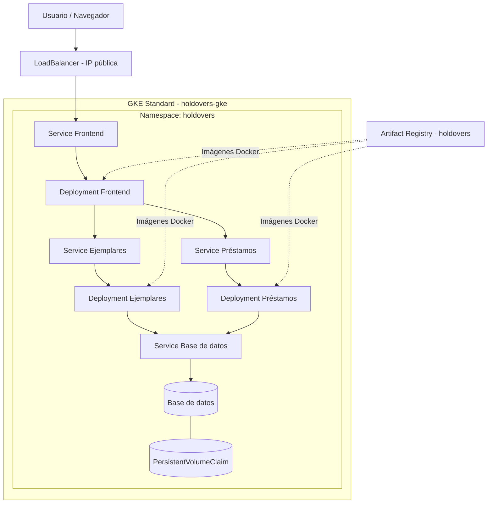

# Arquitectura - Biblioteca GKE

## Diagrama de arquitectura

## Descripción general

El proyecto Biblioteca GKE utiliza una arquitectura basada
en microservicios desplegados en Google Kubernetes Engine.

El sistema permite administrar ejemplares y préstamos
mediante una interfaz web y operaciones CRUD.

La infraestructura de Google Cloud se administra mediante
Terraform, mientras que los componentes de la aplicación
se despliegan utilizando manifiestos de Kubernetes.

## Infraestructura de Google Cloud

- Proveedor: Google Cloud Platform.
- Región: `us-central1`.
- Zona: `us-central1-a`.
- Clúster GKE Standard zonal: `holdovers-gke`.
- Node pool: `pool-holdovers`.
- Nodos: 2 máquinas `e2-small` Spot.
- Disco de arranque: 30 GB por nodo.
- Namespace Kubernetes: `holdovers`.
- Repositorio de Artifact Registry: `holdovers`.
- Cuenta de servicio: `nodos-holdovers`.

La cuenta de servicio dispone de permisos de lectura
sobre Artifact Registry para permitir que los nodos
descarguen las imágenes Docker.

## Componentes de la aplicación

### Frontend

Interfaz web que permite a los usuarios interactuar
con las funciones de la biblioteca.

### Microservicio Ejemplares

API responsable de administrar los ejemplares
disponibles en la biblioteca.

Operaciones principales:
- Crear ejemplares.
- Consultar ejemplares.
- Actualizar ejemplares.
- Eliminar ejemplares.

### Microservicio Préstamos

API responsable de administrar los préstamos
y su relación con los ejemplares.

Operaciones principales:
- Crear préstamos.
- Consultar préstamos.
- Actualizar préstamos.
- Eliminar préstamos.

### Base de datos

Almacena de forma persistente la información
de ejemplares y préstamos.

El almacenamiento persistente se implementará
mediante un PersistentVolumeClaim (PVC).

## Comunicación entre componentes

El usuario accede a la aplicación mediante
una dirección IP pública proporcionada por
un LoadBalancer de Kubernetes.

El frontend interactúa con los microservicios
de Ejemplares y Préstamos.

Los Services de Kubernetes permiten la
comunicación interna entre los componentes.

Los microservicios acceden a la base de datos
para consultar y modificar la información.

El mecanismo definitivo de acceso del navegador
a las APIs se confirmará durante la integración.

## Imágenes Docker

Las tres imágenes previstas son:

- `frontend:v1`
- `ejemplares:v1`
- `prestamos:v1`

Las imágenes se almacenarán en Google Artifact Registry.

Formato de las rutas:

`us-central1-docker.pkg.dev/<PROYECTO>/holdovers/<imagen>:<tag>`

Terraform proporciona el prefijo mediante:

`terraform output -raw ruta_imagenes`

## Administración de infraestructura

Terraform administra los recursos de Google Cloud,
incluyendo:

- APIs necesarias.
- Repositorio Artifact Registry.
- Cuenta de servicio para los nodos.
- Clúster GKE Standard.
- Node pool de máquinas Spot.

Los manifiestos de Kubernetes administrarán:

- Namespace.
- Deployments.
- Services.
- ConfigMap.
- Secret.
- PersistentVolumeClaim.

## Estado de la arquitectura

Este documento representa la arquitectura objetivo
del Proyecto Final Biblioteca GKE.

Los puertos, rutas de API, nombres definitivos de
Services, tecnología de base de datos y comunicación
entre componentes deberán confirmarse cuando
se integren los microservicios y los manifiestos
Kubernetes desarrollados por el equipo.
